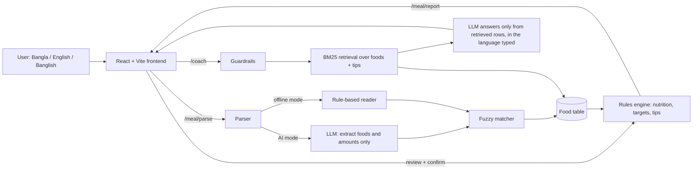

# 🥗 EdiByte

**Bangla-first AI nutrition coach for everyday Bangladeshi food.**
Type what you ate in Bangla, English or Banglish. EdiByte finds the foods, adds up the nutrition from a food table, and gives simple tips.

Built by **Team Qbits** for the International AI Builders Congress 2026.

**Live demo:** https://es-ratt.github.io/edibyte/
> The live demo runs the interface on sample data until the backend is connected (the app shows a "Demo mode" banner when this is the case). See [DEPLOY.md](DEPLOY.md) to connect the real backend.

---

## The problem

Most nutrition apps are built around Western foods and English. Many people in Bangladesh have no easy way to see what is in a home-cooked meal such as *bhat, dal, dim, alu vorta*, and typing in Bangla or Banglish is not supported.

## What EdiByte does

1. **Write your meal** in Bangla, English, Banglish or a mix: "ek plate bhat, dal ar dim".
2. **Review the items.** The AI can make mistakes, so you confirm or correct every food and amount.
3. **Get your report.** Calories, protein, carbs, fat, plus 2-3 simple tips for your goal.
4. **Ask the coach.** Ask in Bangla, English or Banglish and get the answer in the same language.
5. **Track your week.** A history page shows calories per day against your target.

## Design principles (why you can trust the numbers)

- **The AI never invents nutrition numbers.** The language model only reads your words (food names and amounts) and writes the coach's wording. Every calorie and nutrient comes from a food table through a deterministic rules engine.
- **Human in the loop.** Nothing goes into a report until you review the detected items.
- **Safety guardrails.** Questions about medical conditions, pregnancy or extreme dieting get a kind redirect to a doctor or dietitian instead of advice. Calorie targets never go below a safe floor.
- **Works without AI.** If no LLM is configured or the provider fails, the app falls back to a rule-based mode and says so ("Offline mode").
- **Privacy.** No accounts are required. Profile, chat and history are stored in your browser. Server logs do not contain what users typed.

## Architecture



## What works today

| Area | Status |
|---|---|
| Meal text parsing (Bangla / English / Banglish / mixed) | ✅ Working (AI mode with an LLM key, rule-based otherwise) |
| Review and edit detected items | ✅ Working |
| Nutrition report, macro chart, tips | ✅ Working |
| Coach (answers in the language typed) | ✅ Working (natural AI answers need an LLM key; offline mode gives template answers) |
| Safety guardrails | ✅ Working (keyword based) |
| Weekly meal history (on this device) | ✅ Working |
| Demo profiles and "Try Demo" flow | ✅ Working |
| Bangla / English interface | ✅ Working |
| Photo input | 🧪 Backend feature flag, off by default |
| Login | 🧪 Demo only: no password, saved in the browser |
| Real food data | 🔌 The current 48-food table is an **unverified sample**. See [docs/DATA_VERIFICATION.md](docs/DATA_VERIFICATION.md) |
| Price data and budget swaps | 🔌 Not available until sourced, dated prices are added. The app never guesses prices |
| Shopping list | 🗓️ Planned |

## Evaluation (honest numbers)

- **Meal matching:** `backend/eval/` runs the real parsing pipeline on 34 team-written meals (10 Bangla, 10 English, 10 Banglish, 4 mixed). In offline mode it matches every food id (precision, recall and exact-match all 1.0). This set was written by the team and is small, so treat it as a regression check, not proof of accuracy on real users' meals. It measures food matching only, not portion or nutrient accuracy.
- **Automated tests:** backend `pytest` suite and frontend unit tests, run on every pull request by GitHub Actions (`.github/workflows/ci.yml`).
- **Not yet done:** testing with real users and nutritionist review of the food table and tips.

## Known limitations

- Nutrition values are estimates, and the current food table is unverified sample data.
- AI food recognition can make mistakes, so portions need checking.
- The free backend host sleeps when idle, so the first request can take up to a minute.
- Safety guardrails are keyword based and can miss unusual wording.
- This is general nutrition information, not medical advice.

## Tech stack

**Frontend:** React 19, TypeScript, Vite, Tailwind CSS, React Router, Recharts, Vitest
**Backend:** Python, FastAPI, SQLModel (SQLite locally, PostgreSQL in deployment), RapidFuzz (matching), BM25 (retrieval)
**AI:** provider-agnostic (Gemini, Anthropic or OpenAI) through environment variables, with an offline fallback

## Project structure

```
edibyte/
├── frontend/        React app (pages, components, i18n, API client, mock data)
├── backend/         FastAPI app (parser, matcher, rules, coach, guardrails)
│   ├── data/        foods_seed.csv, tips_seed.csv
│   ├── eval/        meal-matching evaluation set and results
│   └── tests/       pytest suite
├── docs/            data verification guide, prototype
├── .github/workflows/  CI and GitHub Pages deploy
├── API_CONTRACT.md  request/response shapes
├── DEPLOY.md        how to deploy the backend and connect the frontend
└── PITCH.md         3-minute demo script
```

## Run it locally

**Backend**
```bash
cd backend
python -m venv .venv && source .venv/bin/activate   # Windows: .venv\Scripts\activate
pip install -r requirements.txt
cp .env.example .env        # leave LLM_PROVIDER=none for offline mode
uvicorn app.main:app --reload
# API docs: http://localhost:8000/docs
```

**Frontend**
```bash
cd frontend
corepack enable && pnpm install
cp .env.example .env.local   # VITE_API_BASE_URL=http://localhost:8000
pnpm dev                     # http://localhost:5173
```

**Tests**
```bash
cd backend && python -m pytest -q
cd frontend && pnpm typecheck && pnpm test
```

## Environment variables

| Where | Variable | Purpose |
|---|---|---|
| Frontend | `VITE_API_BASE_URL` | Backend URL (no trailing slash) |
| Frontend | `VITE_USE_MOCK_DATA` | `true` = sample data without a backend (shows a Demo banner) |
| Backend | `LLM_PROVIDER`, `LLM_MODEL`, `LLM_API_KEY` | Turn on AI mode. Keep the key on the backend only |
| Backend | `CORS_ORIGINS` | Allowed frontend origins, comma separated |
| Backend | `DATABASE_URL` | SQLite locally, PostgreSQL in deployment |
| Backend | `ENABLE_PHOTO` | Photo input (needs a vision-capable model) |

Never put secret keys in frontend variables: Vite exposes `VITE_*` values to the browser.

## Roadmap

- Replace the sample food table with sourced data (Bangladesh food composition table / USDA) and nutritionist review
- Add dated market prices to power the budget swaps and a shopping list
- Real accounts and synced history
- Voice input for Bangla
- User testing with students and families

## Contributing

1. Create a branch: `git checkout -b feature/short-description`
2. Make a focused change and run the tests
3. Push and open a pull request. CI runs automatically.

## License

[MIT](LICENSE). Nutrition data and tips must carry their own sources (see `docs/DATA_VERIFICATION.md`).

---
*EdiByte gives general nutrition information only. It is not medical advice, diagnosis or treatment.*
