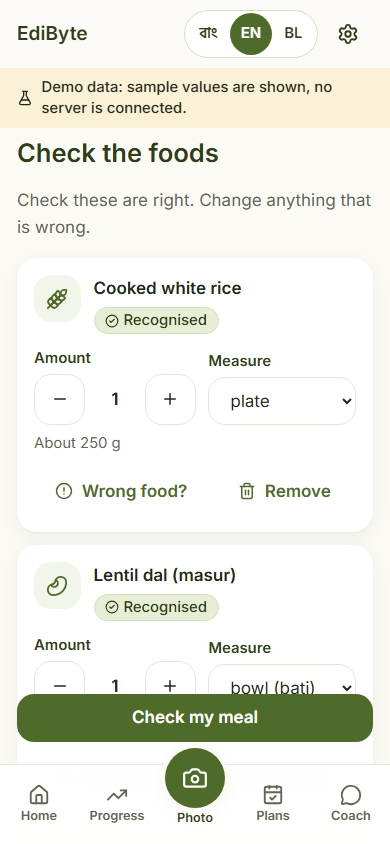
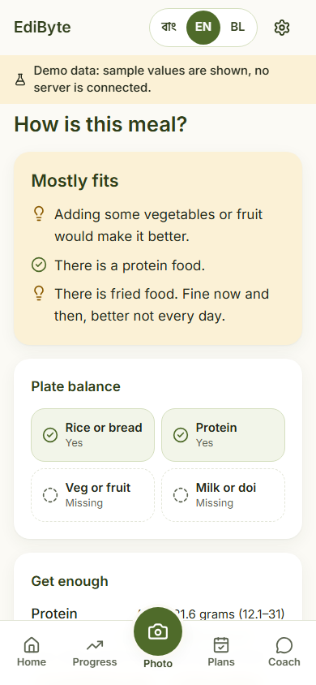
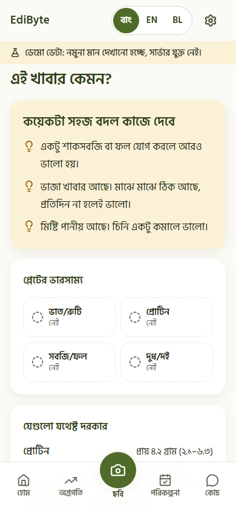
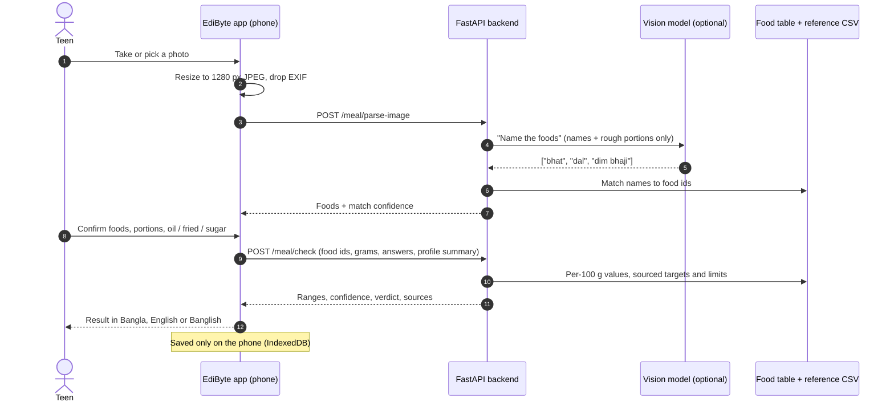
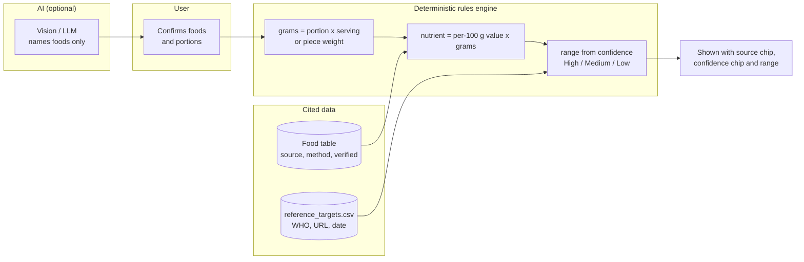
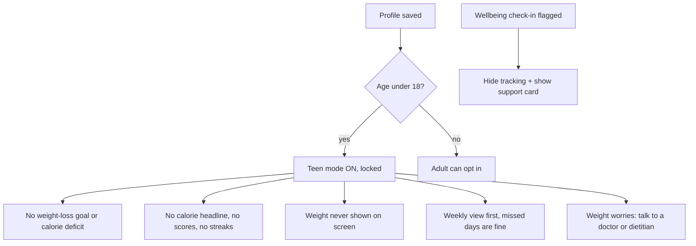
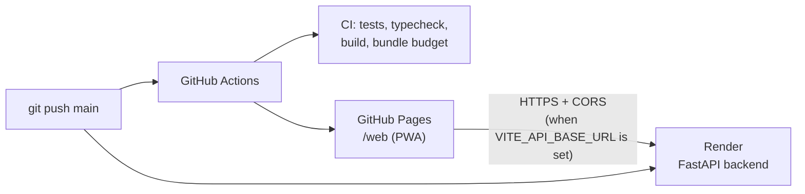
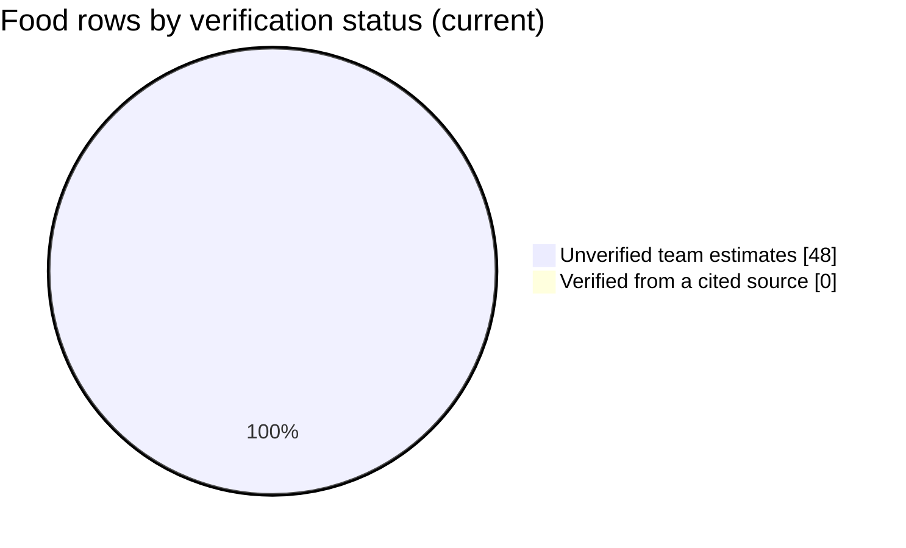
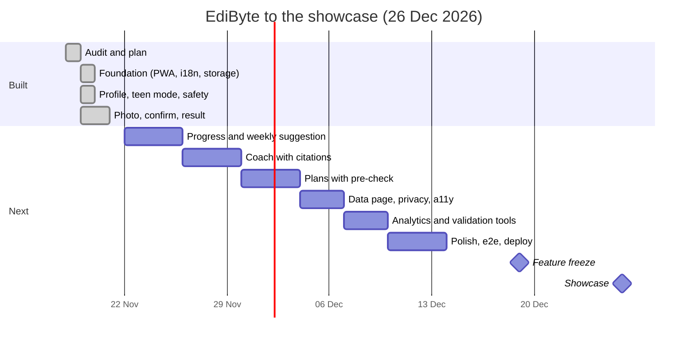

<div align="center">

# EdiByte

### Is this meal right for me? Nutrition guidance for Bangladeshi teens

Take a photo of your meal, confirm the foods, and see how it fits **your** goal, with honest ranges, sources and confidence on every number.

<a href="https://es-ratt.github.io/edibyte/"></a>

[](https://github.com/es-ratt/edibyte/actions/workflows/ci.yml)
[](https://github.com/es-ratt/edibyte/actions/workflows/deploy-frontend.yml)


[](LICENSE)

**Team Qbits** · International AI Builders Congress 2026 · *Idea to Unicorn* · Challenge: **Nutrition Intelligence**

</div>

---

## Try it now

| | |
|---|---|
| **Live demo** | **[es-ratt.github.io/edibyte](https://es-ratt.github.io/edibyte/)**, works on any phone or laptop, no sign-up |
| **What runs there** | The full app in **demo mode**: the real rules engine runs in your browser on the project's food table. A yellow "Demo data" banner is always shown. |
| **Try this** | Choose a language → enter a birth year (try an age under 18 to see teen mode) → tap **Photo** → pick any image from your gallery (the demo always recognises a sample meal) **or** type `bhat dal shak` → confirm → see the result. |
| **Backend API** | Not deployed yet. One-click setup on Render from this repo: see [DEPLOY.md](DEPLOY.md). |

> **Honest status.** All 48 foods in the current table are **unverified team estimates**, labelled as such in the app. Nutrients we do not have yet (sugar, sodium, saturated and trans fat, iron, zinc, calcium) are shown as *"not in our data yet"*, never guessed. EdiByte gives general nutrition information, **not medical advice**.

---

## Contents

1. [Why EdiByte](#why-edibyte)
2. [Screenshots](#screenshots)
3. [Features](#features)
4. [How it works](#how-it-works)
5. [Trust model](#trust-model)
6. [Teen safety by design](#teen-safety-by-design)
7. [Architecture](#architecture)
8. [Tech stack](#tech-stack)
9. [Project structure](#project-structure)
10. [Getting started](#getting-started)
11. [API](#api)
12. [Testing and quality](#testing-and-quality)
13. [Deployment](#deployment)
14. [Data and sources](#data-and-sources)
15. [Roadmap](#roadmap)
16. [Team](#team)
17. [License](#license)

---

## Why EdiByte

Bangladeshi teenagers eat a mix of traditional home food (bhat, dal, shak, mach) and street, fast and packaged food (fuchka, singara, burgers, soft drinks). Most nutrition apps are built for Western foods, English and adult weight loss, and they hide how uncertain their numbers are.

EdiByte answers one everyday question, *"is this meal right for my diet and goal?"*, in **Bangla, English or Banglish**, with three promises:

- **Verified data, not AI guesses.** Every number comes from a food table or a cited guideline. The AI only names foods; it never produces nutrition numbers.
- **Honest ranges.** Every amount shows a range and a confidence level. A photo can never be exact, so the app never pretends it is.
- **The user confirms.** Nothing is calculated until the user has checked the foods and portions.

---

## Screenshots

<table>
<tr>
<td align="center"><br><sub>Welcome (Bangla first)</sub></td>
<td align="center"><br><sub>Home: photo card, week dots, no scores</sub></td>
<td align="center"><br><sub>Confirm foods and household portions</sub></td>
</tr>
<tr>
<td align="center"><br><sub>Verdict and plate balance</sub></td>
<td align="center"><br><sub>Ranges, confidence and source on every number</sub></td>
<td align="center"><br><sub>Full Bangla support</sub></td>
</tr>
</table>

---

## Features

| Area | What it does | Status |
|---|---|---|
| **Profile** | Birth year and month, sex, optional height/weight, activity with Bangladeshi examples, teen-safe goals, diet (any / vegetarian / no beef), allergy avoid-list, meals per day, where you eat, fasting, optional budget. Stored only on the phone. | Done |
| **Teen mode** | Automatic under 18: no weight-loss goals, no calorie headline, no scores or streaks, weight never shown, notifications off. | Done |
| **Photo → confirm** | Camera or gallery, client-side resize (drops EXIF, photo never stored), foods recognised by name only, "not sure" highlight, household portions (bati, plate, piece, glass), questions a photo cannot answer (oil, fried, sugar spoons). | Done |
| **Meal result** | Fits / mostly / change verdict with gentle reasons, plate balance, "get enough" and "go easy" sections with range bars, confidence and source chips, add-ons and swaps that respect diet and avoid-list, "I can't verify allergens" notice. | Done |
| **Guidance** | WHO limits and targets loaded from the source with URL and date. Values without an approved reference say "pending expert review". | Done |
| **Safety switches** | Pause tracking, hide numbers, delete all my data, wellbeing check-in placeholder (questions to be written by a psychologist), support card. | Done |
| **Progress** | Weekly habits (vegetables, protein, sugary drinks, fried food), monthly and yearly views, one rule-based weekly suggestion. | Next |
| **Coach** | Follow-up questions about the meal, answers only from an approved knowledge base with citations. | Planned |
| **Plans** | Day, week and month plans with a pre-check using the same engine; treat days built in. | Planned |

---

## How it works



Without an AI key, photos fall back to typing (`bhat 300g dal 200ml`); the rule-based parser handles Bangla, English and Banglish, counts (`2ta`), household units and negation (`bhat chara`).

---

## Trust model

Every number on screen follows the same path. The language model is kept out of it.



| Rule | How it is enforced |
|---|---|
| The LLM never produces numbers | Its JSON schema only allows names and rough portions (`extra="forbid"`); numbers come from `check.py`. |
| Unknown is not zero | Missing nutrients are `null` and shown as "not in our data yet". |
| `verified` needs proof | A row is verified only with a source URL, a reviewer and a check date. |
| Targets need a source | Every target and limit lives in `backend/data/reference_targets.csv` with source, URL and date; empty rows show "pending expert review". |
| Two kinds of percentages | "% of your daily target" (things to get enough of) vs "share of this meal's energy" or "% of your daily limit" (things to go easy on). |

**Confidence levels:** simple foods start *High*; mixed dishes, street, restaurant and packaged food start *Low*; unverified data is capped at *Medium*; photo portions, assumed portions and unsure matches lower it further.

---

## Teen safety by design

Research links diet-tracking apps, especially tracking for weight or shape and frequent use, with more disordered-eating symptoms in young people, and adolescents are under-researched. EdiByte is built around that:



Also: no "bad food" wording, amber (never red) for limits, terracotta only for allergy and medical notices, an avoid-list that is clearly *not* an allergy guarantee, and a check-in whose questions must come from a qualified reviewer (none are invented by engineers).

---

## Architecture


- **Local-first.** Profile, meals and plans stay on the device. The server receives only what it needs: food ids, grams, answers and a profile *summary* (age, sex, activity, goal, diet), never the birth date, weight or avoid-list.
- **One source of truth.** The demo adapter imports the same CSV files as the API. A TypeScript port of the check engine is verified against fixtures produced by the Python engine; any drift fails CI.
- **Offline.** The app shell, fonts and icons are cached by a service worker; nutrition answers are never cached.

---

## Tech stack

| Layer | Technology |
|---|---|
| Web app | React 19, TypeScript, Vite 8, Tailwind CSS 4 (design tokens), React Router 7, Zustand, `idb`, `vite-plugin-pwa`, Lucide icons, Hind Siliguri + Inter (self-hosted) |
| Backend | Python 3.12, FastAPI, SQLModel, rapidfuzz (matching), rank-bm25 (coach retrieval), httpx |
| AI (optional) | Provider-agnostic: Gemini, Anthropic Claude or OpenAI, configured by environment variables |
| Data | CSV files in `backend/data/` imported into SQLite (local) or Postgres (deploy) |
| Testing | pytest, Vitest, Testing Library, golden-fixture parity tests, headless-browser click-through |
| CI/CD | GitHub Actions (tests, typecheck, build, bundle budget), GitHub Pages (web), Render (API) |

---

## Project structure

```text
edibyte/
├── web/                      # New PWA (deployed to GitHub Pages)
│   └── src/
│       ├── app/              # router, layout, store
│       ├── routes/           # Welcome, Onboarding, Home, Capture, Confirm, Result, Settings, ...
│       ├── features/         # profile, capture, report, safety
│       ├── lib/
│       │   ├── api/          # Api interface, live client, demo adapter
│       │   ├── check/        # demo engine (port of check.py) + parity fixtures
│       │   ├── db/           # IndexedDB
│       │   ├── i18n/         # bn (source) / en / banglish
│       │   └── targets/      # reference targets
│       └── styles/           # design tokens with measured contrast
├── backend/
│   ├── app/                  # FastAPI: parser, matcher, check engine, reference, coach, routers
│   ├── data/                 # foods_seed.csv, reference_targets.csv, tips_seed.csv
│   ├── eval/                 # parser regression set, demo fixture exporter
│   └── tests/                # pytest
├── frontend/                 # Legacy app (kept until /web replaces it)
├── docs/                     # REBUILD_PLAN.md, DATA_VERIFICATION.md, screenshots
├── API_CONTRACT.md
├── DEPLOY.md
└── render.yaml
```

---

## Getting started

**Requirements:** Python 3.12, Node.js 22, pnpm 10.

**Terminal 1: backend**
```bash
cd backend
python -m venv .venv
.venv/Scripts/activate          # Windows; on macOS/Linux: source .venv/bin/activate
pip install -r requirements.txt
uvicorn app.main:app --reload   # http://localhost:8000/docs
```

**Terminal 2: web app**
```bash
cd web
cp .env.example .env.local      # VITE_API_BASE_URL=http://localhost:8000
pnpm install
pnpm dev                        # http://localhost:5173
```

Leave `VITE_API_BASE_URL` empty to run the web app alone in demo mode.

**Optional AI mode** (`backend/.env`):

| Variable | Purpose |
|---|---|
| `LLM_PROVIDER` | `gemini`, `anthropic`, `openai` or `none` (default) |
| `LLM_MODEL`, `LLM_API_KEY` | Model id and key (backend only, never in the web app) |
| `ENABLE_PHOTO` | `true` to accept photos (needs AI mode) |
| `DATABASE_URL` | Postgres URL; blank = local SQLite |
| `CORS_ORIGINS` | Allowed web origins |
| `TRUST_PROXY` | `true` only behind a trusted proxy (Render) |

---

## API

Interactive docs at `/docs` when the backend runs. Full contract: [API_CONTRACT.md](API_CONTRACT.md).

| Method | Path | Purpose |
|---|---|---|
| `GET` | `/health` | Status, mode (AI or offline), photo flag |
| `POST` | `/meal/parse` | Text → foods (names, amounts, match confidence, unmatched with suggestions) |
| `POST` | `/meal/parse-image` | Photo → foods (vision model names foods only; photo not stored) |
| `POST` | `/meal/check` | Confirmed foods + answers + profile summary → ranges, sections, verdict, sources |
| `GET` | `/reference/targets` | Sourced targets and limits for an age and sex, or "unavailable" |
| `GET` | `/foods?query=` | Food search |
| `POST` | `/coach` | Nutrition questions with sources and safety guardrails |
| `GET` | `/data/status` | Verified vs unverified counts by source |
| `DELETE` | `/session/data` | Delete anonymous server-side meal logs |

---

## Testing and quality

```bash
cd backend && python -m pytest -q
cd web && pnpm typecheck && pnpm test && pnpm build && pnpm size
```

| Suite | Result | Covers |
|---|---|---|
| Backend (pytest) | **100 passing** | Parser and matcher (incl. regression tests for every fixed bug), check engine, reference targets, guardrails, rate limiting, migrations |
| Web (Vitest) | **77 passing** | i18n completeness, no hard-coded UI strings, IndexedDB, profile and teen rules, onboarding, settings, photo → confirm → result flows, demo-engine parity with Python |
| Legacy frontend | 9 passing | Kept green until replaced |
| Bundle budget | 150 KB / 200 KB JS (gzip) | Checked in CI for mobile data |
| Parser regression set | 34 / 34 meals | Team-written; a regression check, **not** an accuracy result |

Every phase is also checked in a real headless browser at phone size (390 × 844), in demo and live mode.

**Accuracy is not measured yet.** The plan is a validation on 100+ meals weighed on a kitchen scale (including street and fast food), reporting mean error for energy, protein, sodium and sugar, with failures included.

---

## Deployment



- **Web:** every push to `main` that touches `web/` or `backend/data/` rebuilds GitHub Pages. Without a backend URL it runs in demo mode.
- **Backend:** Render Blueprint from `render.yaml`, no secrets required (offline mode). Step-by-step guide: [DEPLOY.md](DEPLOY.md).

---

## Data and sources



| Data | Source | Status |
|---|---|---|
| Food composition (48 foods) | Team estimates | **Unverified.** To be replaced from the Food Composition Table for Bangladesh (INFS, University of Dhaka) once reuse permission is confirmed |
| Limits and targets | [WHO Healthy diet fact sheet](https://www.who.int/news-room/fact-sheets/detail/healthy-diet) (26 Jan 2026): free sugars, saturated fat, trans fat, fruit and vegetables; total fat and sodium for adults | Sourced, with URL and date |
| Teen energy, protein and micronutrient targets | none chosen yet | **Pending a dietitian-approved reference** (shown as such in the app) |
| Tips | Team-written | Unverified, awaiting dietitian review |

How to add or verify data: [docs/DATA_VERIFICATION.md](docs/DATA_VERIFICATION.md).

---

## Roadmap



**Team tasks outside the code:** reuse permission for the Bangladesh food table, a dietitian to approve teen references and tips, weighing 100+ real meals for validation, an AI vision key for photo recognition, and a legal review of parental consent for minors.

---

## Team

**Team Qbits**

| Role | Member |
|---|---|
| Team Leader / Coordinator | To be confirmed |
| Business Analyst / Data Scientist | To be confirmed |
| UI/UX / Frontend Developer | Esrat Jhahan Nur, Rezwan |
| Backend / Data Engineer | Shopnil |
| Presentation / Communication Lead | Saba |

**AI usage:** AI assistants (Claude) helped with planning, code and documentation; all output is reviewed by the team. In the product, an LLM is used only to name foods and to reword facts the rules engine computed.

---

## License

[MIT](LICENSE) © 2026 Team Qbits

<div align="center">
<sub>EdiByte gives general nutrition information only. It is not medical advice. For health conditions, talk to a doctor or a registered dietitian.</sub>
</div>
