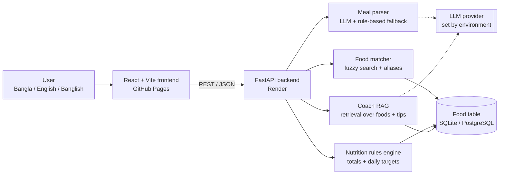
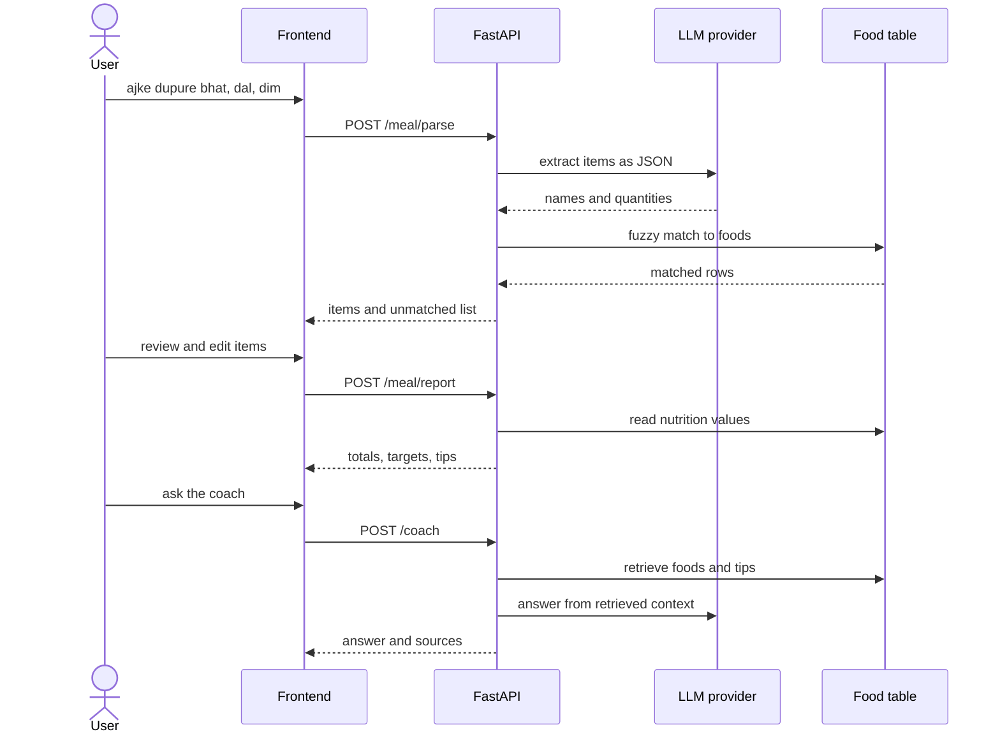
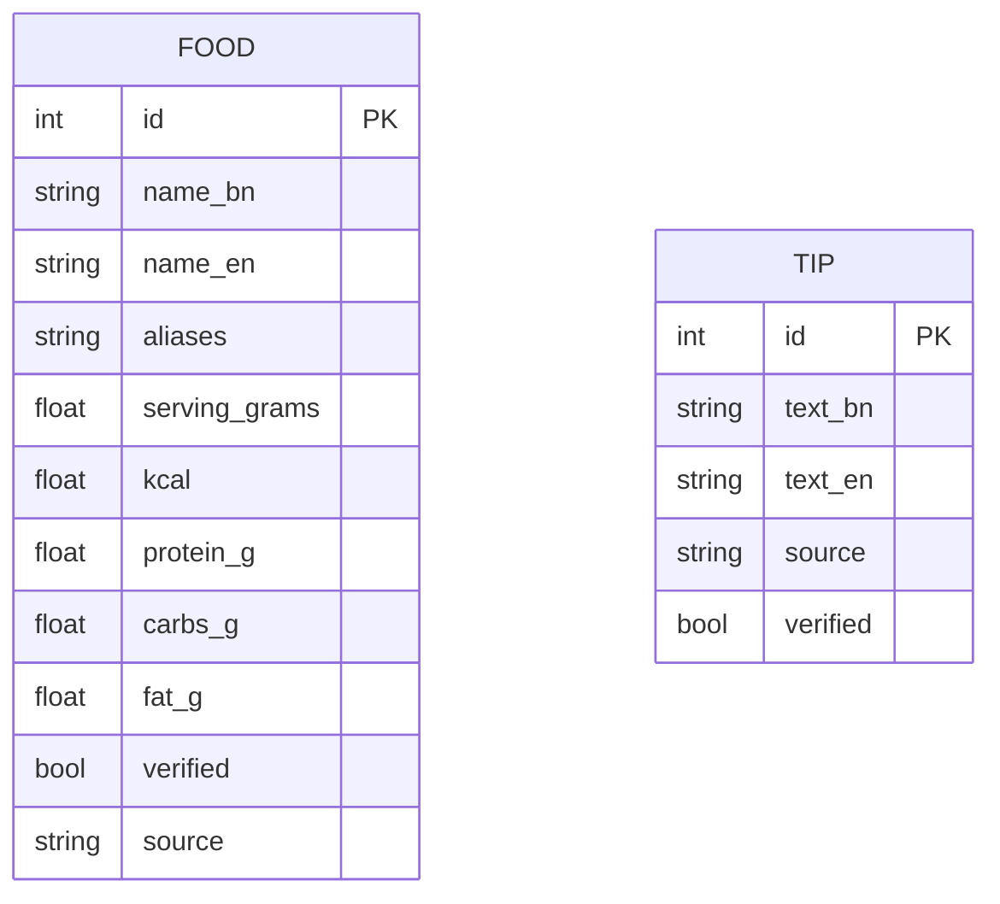
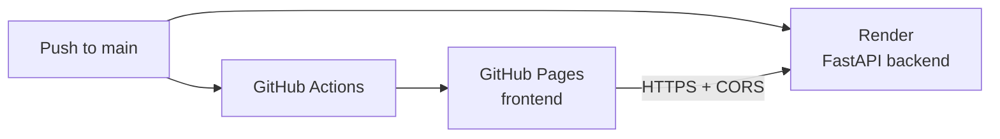

<div align="center">

# EdiByte

### Bangla-first AI nutrition coach

Log what you ate in **Bangla, English or Banglish**. Get nutrition numbers from a real food table, then ask an AI coach that shows its sources.

[](https://es-ratt.github.io/edibyte/)
[](https://github.com/es-ratt/edibyte/actions/workflows/deploy-frontend.yml)


**Team Qbits** · International AI Builders Congress 2026 · Idea to Unicorn
Domain: **FoodSphere AI** · Challenge: **Nutrition Intelligence**

</div>

| Live app | API | API docs | Demo video |
|---|---|---|---|
| [es-ratt.github.io/edibyte](https://es-ratt.github.io/edibyte/) | `<RENDER_URL>` | `<RENDER_URL>/docs` | `<YOUTUBE_URL>` |

---

## Table of contents
1. [Why EdiByte](#why-edibyte)
2. [Features and status](#features-and-status)
3. [Architecture](#architecture)
4. [Request flow](#request-flow)
5. [Data model](#data-model)
6. [Project structure](#project-structure)
7. [Tech stack](#tech-stack)
8. [Getting started](#getting-started)
9. [Configuration](#configuration)
10. [API overview](#api-overview)
11. [Deployment](#deployment)
12. [Testing and evaluation](#testing-and-evaluation)
13. [Responsible AI and limitations](#responsible-ai-and-limitations)
14. [Data sources](#data-sources)
15. [AI usage and transparency](#ai-usage-and-transparency)
16. [Roadmap](#roadmap)
17. [Team and roles](#team-and-roles)
18. [Contributing](#contributing)

---

## Why EdiByte
Most nutrition apps are built around Western foods and English. People in Bangladesh eat home-cooked meals like *bhat, dal, alu vorta* and *shutki*, and have no easy way to see what is in them.

**EdiByte** lets a user write a meal the way they speak, checks it with them, and returns nutrition from a food table, not from an AI guess.

**Who it is for:** students, families and health-conscious people in Bangladesh who want simple, understandable nutrition guidance.

## Features and status
**Legend:** Working · Sample data (working, but the data is unverified) · Planned

| Feature | Description | Status |
|---|---|---|
| Three languages | UI and input in বাংলা, English and Banglish | Working |
| Meal logging | Free-text meals, mixed languages allowed | Working |
| AI meal parsing | LLM extracts items and quantities; rule-based fallback when offline | Working |
| Review step | User checks and edits detected items before any calculation | Working |
| Nutrition report | Calories and macros vs daily targets, charts | Working |
| Personal targets | Targets from a profile; two demo profiles | Working |
| AI coach with sources | Answers grounded in the food table and tips, with source chips | Working |
| Food data | Bangladeshi food table with Bangla, English and Banglish names | Sample data |
| Budget swaps (BDT) | Cheaper alternatives, only when real price data exists | Planned |
| Photo input | Vision-based meal recognition (behind a feature flag) | Planned |

## Architecture


**Design principles**
- **The LLM never produces nutrition numbers.** It only understands text and writes explanations. Calories and macros come from the food table through a deterministic rules engine.
- **Human in the loop.** Every AI-detected item can be edited before the report.
- **Works offline.** With no API key, the app falls back to rule-based parsing and template answers, clearly labeled.
- **Secrets stay on the backend.** The frontend never holds an API key.
- **Unverified data is labeled** everywhere it appears.

## Request flow


## Data model


## Project structure
```text
edibyte/
├── backend/                 # FastAPI service
│   ├── app/                 # API, parser, matcher, rules engine, RAG
│   ├── data/                # Food and tips CSV files
│   ├── eval/                # Evaluation harness and test meals
│   ├── tests/               # pytest tests
│   └── requirements.txt
├── frontend/                # React + Vite + TypeScript app
│   └── src/
│       ├── components/      # Reusable UI components
│       ├── pages/           # Route-level pages
│       ├── services/        # API client
│       ├── types/           # Shared TypeScript types
│       ├── hooks/           # Custom hooks
│       └── lib/             # Helpers and i18n
├── docs/                    # Documentation and screenshots
├── .github/workflows/       # GitHub Pages deployment
├── API_CONTRACT.md          # Request and response shapes
├── render.yaml              # Backend deployment config
└── README.md
```

## Tech stack
| Layer | Technology |
|---|---|
| Frontend | React, Vite, TypeScript, Tailwind CSS, React Router, Recharts, Lucide |
| Backend | Python, FastAPI, Pydantic, SQLModel |
| Database | SQLite (local), PostgreSQL (deployment) |
| Matching and retrieval | rapidfuzz, BM25 |
| LLM | Configurable provider through environment variables |
| Hosting | GitHub Pages (frontend), Render (backend) |
| CI/CD | GitHub Actions |

## Getting started
**Prerequisites:** Node.js (LTS), pnpm (npm also works), Python 3.11+, Git.

```bash
git clone https://github.com/es-ratt/edibyte.git
cd edibyte
```

**Terminal 1: backend**
```bash
cd backend
python -m venv .venv
# Windows: .venv\Scripts\activate    macOS/Linux: source .venv/bin/activate
pip install -r requirements.txt
cp .env.example .env
uvicorn app.main:app --reload --port 8000
```

**Terminal 2: frontend**
```bash
cd frontend
pnpm install
cp .env.example .env
pnpm dev
```
Open the URL printed by Vite (usually http://localhost:5173). With no `LLM_API_KEY`, the backend runs in offline mode.

## Configuration
**Backend (`backend/.env`)**

| Variable | Purpose |
|---|---|
| `DATABASE_URL` | SQLite locally, PostgreSQL in deployment |
| `LLM_PROVIDER` | `gemini`, `anthropic`, `openai` or `none` |
| `LLM_MODEL` | Model name, read from the environment |
| `LLM_API_KEY` | Provider key (never commit this) |
| `CORS_ORIGINS` | Allowed frontend origins, include `https://es-ratt.github.io` |
| `ENABLE_PHOTO` | Feature flag for photo input, off by default |

**Frontend (`frontend/.env`)**

| Variable | Purpose |
|---|---|
| `VITE_API_BASE_URL` | Backend URL, for example `http://localhost:8000` |
| `VITE_USE_MOCK_DATA` | `true` for UI-only work without the backend |

> `VITE_*` values are public in the browser. Keep every secret on the backend.

## API overview
Full request and response shapes are in [API_CONTRACT.md](API_CONTRACT.md).

| Method | Endpoint | Purpose |
|---|---|---|
| GET | `/health` | Status and mode (AI or offline) |
| POST | `/meal/parse` | Text to matched food items |
| POST | `/meal/report` | Items and profile to totals, targets, tips |
| POST | `/coach` | Question to grounded answer with sources |
| GET | `/foods` | Search the food table |
| GET | `/profiles/demo` | Demo profiles |
| GET | `/eval/results` | Latest evaluation results |

## Deployment

1. **Backend:** create a Render Blueprint from `render.yaml`, then set the environment variables in the Render dashboard.
2. **Frontend:** in GitHub, go to Settings, then Pages, then Source: **GitHub Actions**.
3. **Connect them:** in Settings, then Secrets and variables, then Actions, then Variables, add `VITE_API_BASE_URL` (the Render URL) and `VITE_USE_MOCK_DATA` set to `false`.
4. Push to `main`. The workflow in `.github/workflows/deploy-frontend.yml` builds and publishes the site.

> Until the backend is live and these variables are set, the site builds in demo mode with mock data, and it shows a "Demo data" badge.
> The free Render tier sleeps when idle, so the first request can take a while.

## Testing and evaluation
```bash
cd backend
pytest
python -m eval.run
```
The evaluation harness runs team-made test meals (Bangla, Banglish, English, mixed) and writes `backend/eval/results.json`.

| Metric | Result |
|---|---|
| Item matching accuracy on the team-made test set | _Not run yet_ |

Numbers are added here only after the harness has been run.

## Responsible AI and limitations
- Nutrition values are **estimates**. The current food table includes unverified sample rows, which are labeled in the app.
- AI parsing can make mistakes, so users review items before calculation.
- EdiByte gives **general nutrition information only**. It is not medical advice, diagnosis or treatment.
- The coach redirects medical, pregnancy and extreme-diet questions to a doctor or dietitian.
- The demo stores no real personal health data.

## Data sources
| Data | Source | Licence | Status |
|---|---|---|---|
| Bangladeshi food table | Team-made sample | n/a | Unverified, to be replaced with sourced data |
| Nutrition tips | Team-made sample | n/a | Unverified |

Every dataset added later must list its source and licence here.

## AI usage and transparency
- **Development:** AI assistants (Claude) were used for planning, code generation and documentation. All output was reviewed by the team.
- **In the product:** an LLM, configured by environment variables, is used only for text understanding and explanations. See [Architecture](#architecture).

## Roadmap
- [x] Bangla, English and Banglish UI
- [x] Meal parsing, review step and nutrition report
- [x] Grounded AI coach with sources
- [ ] Replace sample food data with verified, licensed data
- [ ] Publish evaluation results
- [ ] Budget-aware swaps with real price data
- [ ] Photo input
- [ ] Regional language support

## Team and roles
**Team Qbits**

| Role | Member |
|---|---|
| Team Leader / Coordinator | _add name_ |
| Business Analyst / Data Scientist | _add name_ |
| UI/UX / Frontend Developer | Esrat Jhahan Nur, Rezwan |
| Backend / Data Engineer | Shopnil |
| Presentation / Communication Lead | Saba |

## Contributing
1. Create a branch: `git checkout -b feature/short-description`
2. Make one focused change and test it.
3. Commit with a clear message, for example `feat(frontend): add profile page`.
4. Push the branch and open a pull request for a teammate to review.

---

<div align="center">

EdiByte gives general nutrition information only. It is not medical advice.
Built by Team Qbits for the International AI Builders Congress 2026.

</div>