<div align="center">

# EdiByte

**Is this meal right for me?** Bangla-first nutrition guidance for Bangladeshi teenagers.

### [▶ Open the live demo](https://es-ratt.github.io/edibyte/)

[Pitch](PITCH.md) · [API contract](API_CONTRACT.md) · [Deployment guide](DEPLOY.md) · [Data verification](docs/DATA_VERIFICATION.md)

A group project by **Team Qbits** for the International AI Builders Congress 2026<br>
Track: *Idea to Unicorn* · Challenge: **Nutrition Intelligence**

</div>

---

## Overview

EdiByte helps a teenager check a meal **before eating it**. They type or photograph the meal, confirm the foods and portions, and get a gentle verdict on how the meal fits their own goal. Every number comes with a range, a confidence level and a source.

Bangladeshi teenagers eat a mix of home food (bhat, dal, shak, mach) and street, fast and packaged food (fuchka, singara, burgers, soft drinks). Most nutrition apps are built for Western foods, English and adult weight loss, and they hide how uncertain their numbers are. EdiByte is built for local food, in **Bangla and English**, with teen safety designed in from the start.

**Three promises**

- **Data, not AI guesses.** Every number comes from a food table or a cited guideline. The AI may only name foods; it never produces nutrition numbers.
- **Honest ranges.** Every amount shows a range and a confidence level, because a meal estimate is never exact.
- **The user confirms.** Nothing is calculated until the user has checked the foods and portions.

> [!IMPORTANT]
> All 48 foods in the current table are **unverified team estimates** and are labelled as such in the app. Nutrients we do not have yet are shown as *"not in our data yet"*, never guessed. EdiByte gives general nutrition information, **not medical advice**.

---

## Live demo

| | |
|---|---|
| **App** | [es-ratt.github.io/edibyte](https://es-ratt.github.io/edibyte/). Works on any phone or laptop, with no sign-up. Installable as an app (PWA). |
| **Backend** | [edibyte-api.onrender.com](https://edibyte-api.onrender.com/docs), connected to the app. It runs on Render's free plan, so the first request after a quiet period can take up to a minute. |
| **Mode** | Rules mode: meal parsing, the check engine and the coach all run without an AI key. Photo recognition turns on once a vision API key is added. |
| **Try this** | Pick a language → enter a birth year (an age under 18 shows teen mode) → type `bhat dal shak` → confirm → see the result → **Ask the coach** → open **Progress** and **Plans**. |

---

## Contents

- [Screenshots](#screenshots)
- [Features](#features)
- [How it works](#how-it-works)
- [Trust model](#trust-model)
- [Teen safety by design](#teen-safety-by-design)
- [Architecture](#architecture)
- [Tech stack](#tech-stack)
- [Getting started](#getting-started)
- [Project structure](#project-structure)
- [API](#api)
- [Testing and quality](#testing-and-quality)
- [Deployment](#deployment)
- [Data and sources](#data-and-sources)
- [Roadmap](#roadmap)
- [Team](#team)
- [Contributing](#contributing)
- [License](#license)

---

## Screenshots

<table>
<tr>
<td align="center">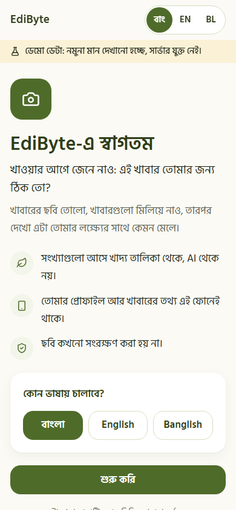<br><sub>Welcome (Bangla first)</sub></td>
<td align="center">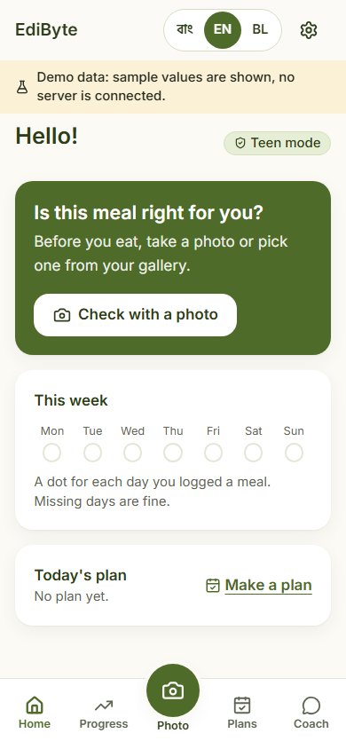<br><sub>Home: week dots and today's plan</sub></td>
<td align="center"><br><sub>Confirm foods and portions</sub></td>
</tr>
<tr>
<td align="center"><br><sub>Verdict and plate balance</sub></td>
<td align="center">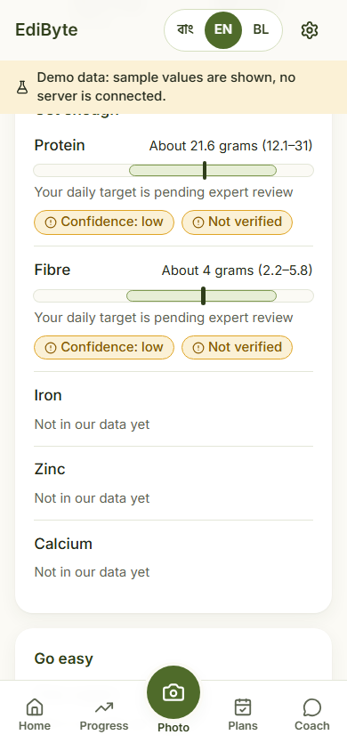<br><sub>Range, confidence and source</sub></td>
<td align="center"><br><sub>Full Bangla support</sub></td>
</tr>
<tr>
<td align="center">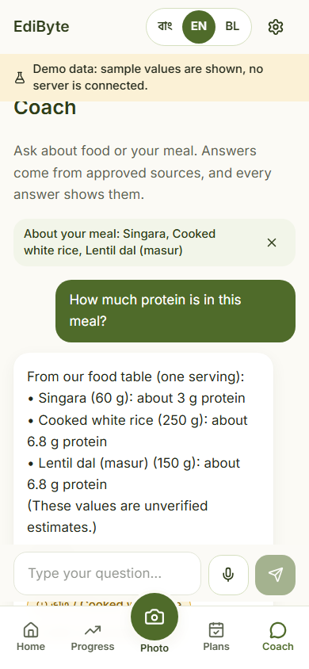<br><sub>Coach with meal context</sub></td>
<td align="center">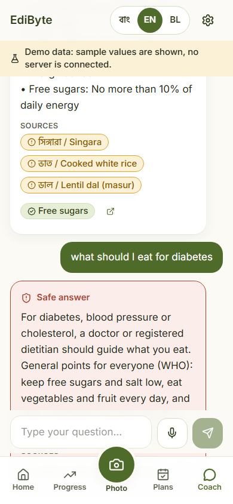<br><sub>Safe answers for health topics</sub></td>
<td align="center"><br><sub>Weekly habits and suggestion</sub></td>
</tr>
<tr>
<td align="center"><br><sub>Day plan pre-check</sub></td>
<td align="center"><br><sub>Every source with a link</sub></td>
<td align="center"><br><sub>WHO guidance, rest pending review</sub></td>
</tr>
</table>

---

## Features

| Area | What it does |
|---|---|
| **Profile** | Birth year and month, sex, optional height and weight, activity level with Bangladeshi examples, teen-safe goals, diet (any, vegetarian, no beef), allergy avoid-list, meals per day, fasting and an optional budget. Stored only on the phone. |
| **Teen mode** | Automatic under 18: no weight-loss goals, no calorie headline, no scores or streaks, weight never shown, notifications off. |
| **Meal capture** | Type a meal in Bangla or English, or take a photo (when AI is enabled). Photos are resized on the device, EXIF is removed and the photo is never stored. |
| **Confirm step** | Household portions (plate, bati, piece), "not sure" highlights, unmatched foods kept visible, and questions a photo cannot answer (oil, fried, sugar spoons). |
| **Meal result** | Gentle verdict, plate balance, "get enough" and "go easy" sections with range bars, confidence and source chips, and add-ons and swaps that respect diet and avoid-list. |
| **Coach** | Follow-up questions with the meal as context. Answers come only from the food table, tips and WHO rows, with citations; any unsupported number is rejected. |
| **Progress** | Week, month and year views of food-group habits, "based on X of Y meals", and one rule-chosen suggestion per week. |
| **Plans** | Day plan pre-checked by the same engine, up to three weekly goals with treat days ("5 of 7 is a win"), and a monthly focus with check-ins. |
| **Safety and privacy** | Pause tracking, hide numbers, delete all data, support card, privacy card and an anonymous-usage switch. |
| **Data and sources** | Verified vs unverified counts, every WHO reference with link and date, accuracy status and "report a mistake". |

---

## How it works

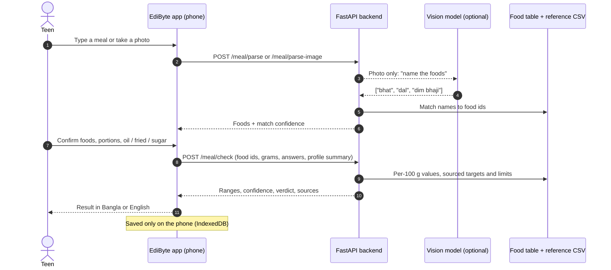

The rule-based parser understands typed meals such as `bhat 300g dal 200ml`, counts (`2ta`), household units and negation (`bhat chara`), in Bangla, English or Banglish spelling.

---

## Trust model

Every number on screen follows the same path, and the language model is kept out of it.

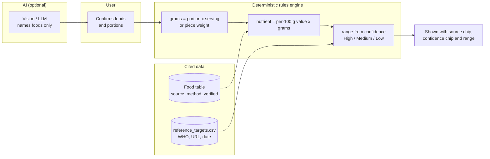

| Rule | How it is enforced |
|---|---|
| The LLM never produces numbers | Its output schema allows only names and rough portions (`extra="forbid"`); numbers come from `check.py`. |
| Unknown is not zero | Missing nutrients are `null` and shown as "not in our data yet". |
| "Verified" needs proof | A row counts as verified only with a source URL, a reviewer and a check date. |
| Targets need a source | Every target and limit lives in `backend/data/reference_targets.csv` with source, URL and date; empty rows show "pending expert review". |
| Coach answers are checked | Any number in a coach answer that is not in the retrieved data discards the answer. |

**Confidence levels:** simple foods start at *High*; mixed dishes and street, restaurant or packaged food start at *Low*; unverified data is capped at *Medium*; assumed portions and unsure matches lower it further.

---

## Teen safety by design

Research links diet-tracking apps, especially tracking for weight or shape and frequent use, with more disordered-eating symptoms in young people. EdiByte is designed around that risk.

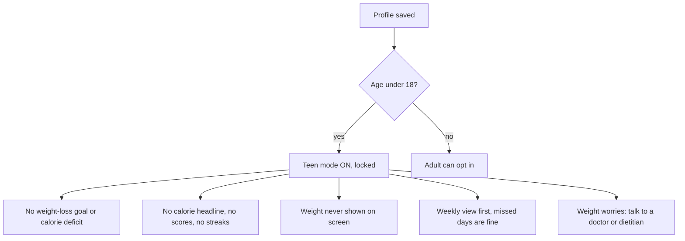

The app also avoids "bad food" wording, uses amber (never red) for limits, and keeps the avoid-list clearly separate from any allergy guarantee. Wellbeing check-in questions must come from a qualified reviewer; none are written by engineers.

---

## Architecture

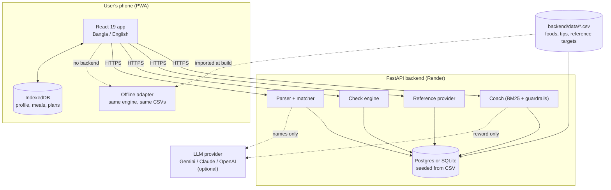

- **Local-first.** Profile, meals and plans stay on the device. The server receives only food ids, grams, answers and a profile *summary* (age, sex, activity, goal, diet), never the birth date, weight or avoid-list.
- **One source of truth.** The offline adapter imports the same CSV files as the API. Its TypeScript check engine is tested against fixtures produced by the Python engine, so any drift fails CI.
- **Works offline.** The app shell, fonts and icons are cached by a service worker; nutrition answers are never cached.

---

## Tech stack

| Layer | Technology |
|---|---|
| Frontend | React 19, TypeScript, Vite 8, Tailwind CSS 4, React Router 7, Zustand, IndexedDB (`idb`), `vite-plugin-pwa` |
| Backend | Python 3.12, FastAPI, SQLModel, rapidfuzz (food matching), rank-bm25 (coach retrieval) |
| AI (optional) | Provider-agnostic: Gemini, Anthropic Claude or OpenAI, set by environment variables |
| Data | CSV files in `backend/data/`, loaded into SQLite (local) or Postgres (production) |
| Testing | pytest, Vitest, Testing Library, axe-core, Playwright |
| CI/CD | GitHub Actions, GitHub Pages (frontend), Render (backend) |

---

## Getting started

**Requirements:** Python 3.12, Node.js 22, pnpm 10.

```bash
git clone https://github.com/es-ratt/edibyte.git
cd edibyte
```

**Terminal 1: backend**

```bash
cd backend
python -m venv .venv
.venv/Scripts/activate            # macOS/Linux: source .venv/bin/activate
pip install -r requirements.txt
uvicorn app.main:app --reload     # http://localhost:8000/docs
```

**Terminal 2: frontend**

```bash
cd frontend
cp .env.example .env.local        # VITE_API_BASE_URL=http://localhost:8000
pnpm install
pnpm dev                          # http://localhost:5173
```

Leave `VITE_API_BASE_URL` empty to run the frontend on its own with the built-in offline adapter.

<details>
<summary><b>Backend environment variables</b> (<code>backend/.env</code>)</summary>

| Variable | Purpose |
|---|---|
| `LLM_PROVIDER` | `gemini`, `anthropic`, `openai` or `none` (default) |
| `LLM_MODEL`, `LLM_API_KEY` | Model id and key (backend only, never in the web app) |
| `ENABLE_PHOTO` | `true` to accept photos (needs an AI provider) |
| `DATABASE_URL` | Postgres URL; blank uses local SQLite |
| `CORS_ORIGINS` | Allowed web origins |
| `TRUST_PROXY` | `true` only behind a trusted proxy (Render) |
| `IMPACT_KEY` | Secret that enables `GET /impact/summary`; empty keeps it off |

</details>

---

## Project structure

```text
edibyte/
├── frontend/                 # React PWA, deployed to GitHub Pages
│   ├── src/
│   │   ├── app/              # router, layout, store
│   │   ├── routes/           # one file per screen
│   │   ├── features/         # profile, capture, report, progress, plans, safety
│   │   └── lib/              # api client, check engine, coach, plans, progress, db, i18n
│   └── e2e/                  # Playwright flows
├── backend/
│   ├── app/                  # FastAPI: parser, matcher, check engine, coach, routers
│   ├── data/                 # foods, tips and reference-target CSVs
│   ├── eval/                 # parser regression set, fixtures, weighed-meal validation
│   └── tests/                # pytest
├── docs/                     # plans, data verification, validation, screenshots
├── legacy-frontend/          # previous app, archived
├── PITCH.md · API_CONTRACT.md · DEPLOY.md
└── render.yaml               # Render blueprint for the backend
```

---

## API

Interactive docs: [edibyte-api.onrender.com/docs](https://edibyte-api.onrender.com/docs). Full contract: [API_CONTRACT.md](API_CONTRACT.md).

| Method | Path | Purpose |
|---|---|---|
| `GET` | `/health` | Status, mode and photo flag |
| `POST` | `/meal/parse` | Text → foods, amounts, match confidence and unmatched items |
| `POST` | `/meal/parse-image` | Photo → foods (the model names foods only; photo not stored) |
| `POST` | `/meal/check` | Confirmed foods + answers + profile summary → ranges, verdict, sources |
| `POST` | `/meal/plan-check` | A planned day, checked slot by slot |
| `GET` | `/reference/targets` | Sourced targets and limits for an age and sex |
| `POST` | `/suggestions` | Habit counts → one rule-chosen weekly tip |
| `GET` | `/foods?query=` | Food search |
| `POST` | `/coach` | Questions with meal context, citations and safety guardrails |
| `POST` | `/events`, `/feedback/item` | Anonymous usage events and wrong-item reports |
| `GET` | `/impact/summary` | Protected adoption summary (needs `IMPACT_KEY`) |
| `GET` | `/data/status` | Verified vs unverified data counts |
| `GET` | `/eval/validation` | Weighed-meal validation results |
| `DELETE` | `/session/data` | Delete anonymous server-side meal logs |

---

## Testing and quality

```bash
cd backend  && ruff check . && python -m pytest -q
cd frontend && pnpm typecheck && pnpm test && pnpm build && pnpm size
cd frontend && pnpm e2e
```

| Suite | Result | Covers |
|---|---|---|
| Backend (pytest) | **137 passing** | Parser, matcher, check engine, plan check, reference targets, coach guardrails and number checks, suggestions, events |
| Frontend (Vitest) | **129 passing** | Every screen flow, teen rules, storage, i18n completeness, no hard-coded strings, engine parity with Python |
| Accessibility (axe-core) | **11 / 11 screens, 0 violations** | WCAG 2.1 A/AA; colour contrast checked in a real browser |
| End-to-end (Playwright) | **5 / 5 flows** | Teen onboarding, meal → result → progress, coach, plans, delete all data |
| Lighthouse (mobile) | Accessibility **100**, Best Practices **100**, SEO **100**, Performance **79–92** | Simulated slow 4G |
| Bundle budget | **183 KB / 200 KB** JS (gzip) | Enforced in CI |

All suites run on every push in GitHub Actions.

> [!NOTE]
> **Accuracy is not measured yet.** The validation tooling is ready ([docs/VALIDATION.md](docs/VALIDATION.md)): 100+ meals weighed on a kitchen scale, error reported per nutrient, failures included. Results will be published exactly as produced.

---

## Deployment

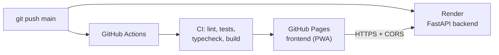

- **Frontend:** every push to `main` that touches `frontend/` or `backend/data/` rebuilds GitHub Pages after the tests pass. The repository variable `VITE_API_BASE_URL` connects it to the backend.
- **Backend:** Render Blueprint from `render.yaml`, redeployed on every push. Step-by-step guide: [DEPLOY.md](DEPLOY.md).

---

## Data and sources

| Data | Source | Status |
|---|---|---|
| Food composition (48 foods) | Team estimates | **Unverified.** To be replaced from the Food Composition Table for Bangladesh (INFS, University of Dhaka) once reuse permission is confirmed. |
| Limits and targets | [WHO Healthy diet fact sheet](https://www.who.int/news-room/fact-sheets/detail/healthy-diet) | Sourced, with URL and date |
| Teen energy, protein and micronutrient targets | Not chosen yet | **Pending a dietitian-approved reference** (shown as such in the app) |
| Tips | Team-written | Awaiting dietitian review |

How to add or verify data: [docs/DATA_VERIFICATION.md](docs/DATA_VERIFICATION.md).

---

## Roadmap

- [x] Profile, teen mode, meal capture, confirm step and result
- [x] Coach, progress, plans, data page
- [x] Accessibility, offline support, CI/CD, live deployment
- [ ] Reuse permission for the Bangladesh food table and sourced data
- [ ] Dietitian review of teen targets, tips and wording
- [ ] AI vision key for photo recognition
- [ ] Weighed-meal validation (100+ meals)
- [ ] Pilot with real users (2+ weeks) and legal review of parental consent

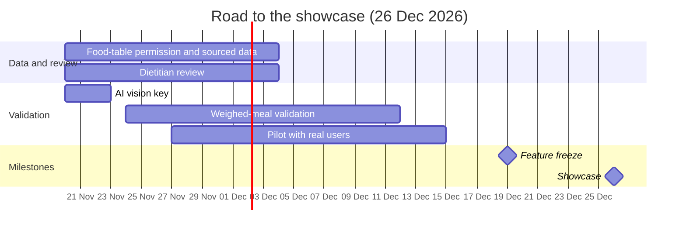

---

## Team

EdiByte is a group project built by **Team Qbits**.

| Role | Member |
|---|---|
| Team Leader / Coordinator | TBA |
| Business Analyst / Data Scientist | TBA |
| UI/UX / Frontend Developer | Esrat Jhahan Nur, Rezwan |
| Backend / Data Engineer | Shopnil |
| Presentation / Communication Lead | Saba |

**AI usage:** AI assistants (Claude) helped with planning, code and documentation, and the team reviews all output. In the product, an LLM is used only to name foods and to reword facts the rules engine has already computed.

---

## Contributing

This repository is maintained by Team Qbits.

1. Create a branch from `main` (`feat/...`, `fix/...`, `docs/...`).
2. Keep commits small, using [Conventional Commits](https://www.conventionalcommits.org/) (`feat:`, `fix:`, `docs:`).
3. Run the tests above before pushing; CI must pass before merging.
4. Never add nutrient values without a source. See [docs/DATA_VERIFICATION.md](docs/DATA_VERIFICATION.md).

---

## License

Released under the [MIT License](LICENSE). © 2026 Team Qbits.

<div align="center">
<br>
<sub>EdiByte gives general nutrition information only. It is not medical advice. For health conditions, talk to a doctor or a registered dietitian.</sub>
</div>
